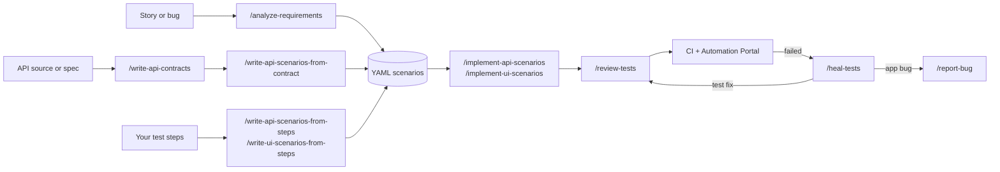

<a href="https://zaytsman.github.io/SimpRight/"><picture><source media="(prefers-color-scheme: dark)" srcset="./.github/assets/banner-dark.svg" /></picture></a>

<p align="center">
  <a href="https://github.com/Zaytsman/SimpRight/actions/workflows/run-api-tests.yml"></a>
  <a href="https://github.com/Zaytsman/SimpRight/actions/workflows/run-ui-tests.yml"></a>
  <a href="https://zaytsman.github.io/SimpRight/"></a>
</p>
<p align="center">
  
  
  <a href="./LICENSE"></a>
</p>

# SimpRight

Automated test framework built with **TypeScript + Playwright**. It covers UI and API tests for the [Practice Software Testing](https://practicesoftwaretesting.com) Toolshop demo app ([API](https://api.practicesoftwaretesting.com)), and it's an example of AI-assisted test automation: Claude Code agents write contracts, scenarios and specs, review the tests and diagnose failures, and a person approves each step.

Every test starts as a scenario in YAML, and the spec follows it step for step:

```yaml
# test-scenarios/ui/products/product-search.yml
- id: UI-001
  name: Search by name shows only matching products
  preconditions:
    - The home page is open.
  steps:
    - Search for "pliers".
    - 'Verify the caption reads "Searched for: pliers".'
```

```ts
// tests/ui/products/product-search.spec.ts
import { openHomePageTest as test, expect } from '@fixtures';

test('UI-001: Search by name shows only matching products', { tag: '@smoke' }, async ({ homePage }) => {
  await test.step('Search for "pliers".', async () => {
    await homePage.search('pliers');
  });

  await test.step('Verify the caption reads "Searched for: pliers".', async () => {
    await expect(homePage.searchCaption, 'The caption names the search term').toHaveText('Searched for: pliers');
  });
});
```

A validator checks that every scenario and its test match: IDs, names, tags and step titles.

## Features

✅ **Shared fixtures** - one set for both layers, with role-based test users; tests start already logged in.<br>
✅ **Per-environment config** - JSON per environment, secrets in a git-ignored `.env`.<br>
✅ **YAML test scenarios** - the source of truth for what gets automated, checked by a schema and a validator.<br>
✅ **API contracts** - every API area documented, with an optional coverage report against them.<br>
✅ **Bug tracking** - one file per root cause, linked to the tests that hit it.<br>
✅ **CI** - nightly regressions, a smoke set and pull request checks on GitHub Actions.<br>
✅ **Automation Portal** - a [dashboard](https://zaytsman.github.io/SimpRight/) on GitHub Pages with run history, known issues, API coverage, test cases and bugs.<br>
✅ **AI agents** - contracts → scenarios → specs → review → healing, with human checkpoints.

## How the AI agents work together

Each step is a Claude Code slash command, and every command stops for your approval before it writes anything.



## Quick start

```bash
npm install
npm run install:browsers
cp .env.example .env   # then fill in ADMIN_USER and ADMIN_PASSWORD
npm run test:smoke
```

You need Node.js 22.18 or later. [Installation & Setup](https://github.com/Zaytsman/SimpRight/wiki/Installation-&-Setup) covers the rest.

## Documentation

Everything is in the **[wiki](https://github.com/Zaytsman/SimpRight/wiki)**:

| | |
|---|---|
| [Installation & Setup](https://github.com/Zaytsman/SimpRight/wiki/Installation-&-Setup) | Install, configure and run the first tests |
| [Test Scenarios](https://github.com/Zaytsman/SimpRight/wiki/Add-API-Scenarios), [Automation](https://github.com/Zaytsman/SimpRight/wiki/API-Automation), [Test Runs](https://github.com/Zaytsman/SimpRight/wiki/Local-Runs) | Add scenarios, automate them, run the tests locally and on CI |
| [Skills](https://github.com/Zaytsman/SimpRight/wiki#skills) | The Claude Code slash commands and the agents they start |
| [Continuous Integration](https://github.com/Zaytsman/SimpRight/wiki/CI-Pipeline) | The workflows, schedules, publishing and the dashboard |
| [Framework](https://github.com/Zaytsman/SimpRight/wiki/Architecture) | How the framework is designed, area by area |

The exact conventions a new test must follow are in [CLAUDE.md](CLAUDE.md).

## Contributing

Fork the repository, branch from `develop` and open a pull request into `develop`. Pull requests run the `verify` check (typecheck, scenario validation and the Test Cases and Bugs page builds), so run the specs you changed locally before you push.

## Security

Please don't open public issues for security problems. Follow [SECURITY.md](SECURITY.md) to report them privately.

## Status

> [!NOTE]
> SimpRight is a demo framework. It tests a public demo shop that other people use at the same time and that re-seeds its data every hour, so the tests are written to cope with shared, changing data. Every API scenario is automated; the UI suite is partly automated, and its remaining scenarios are written and waiting.

## License

[MIT](LICENSE) © Andrii Zaitsev
